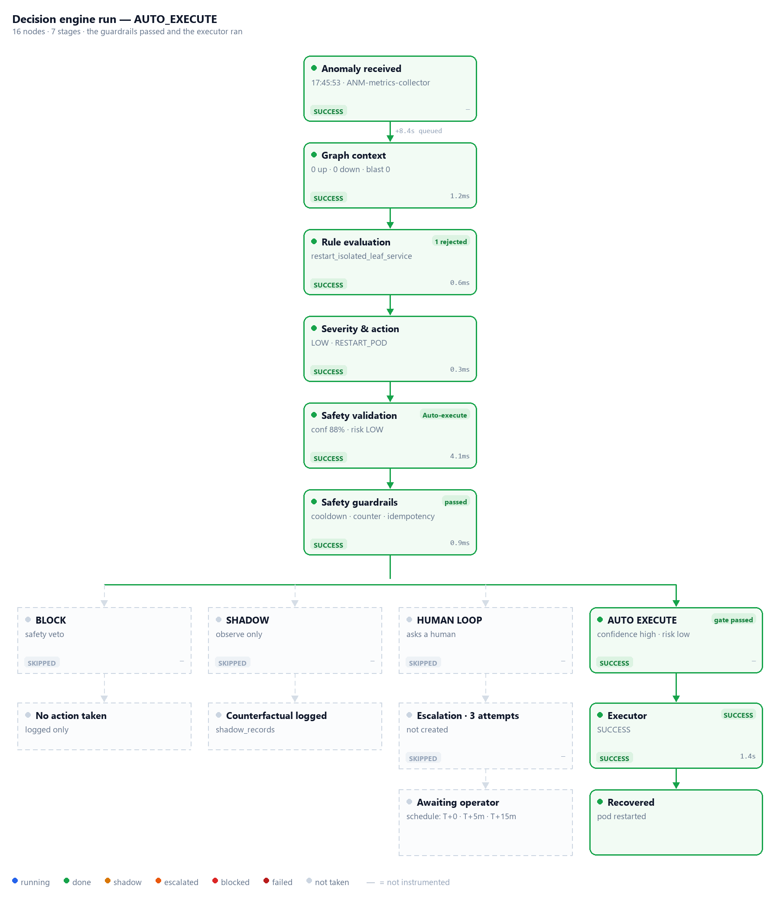
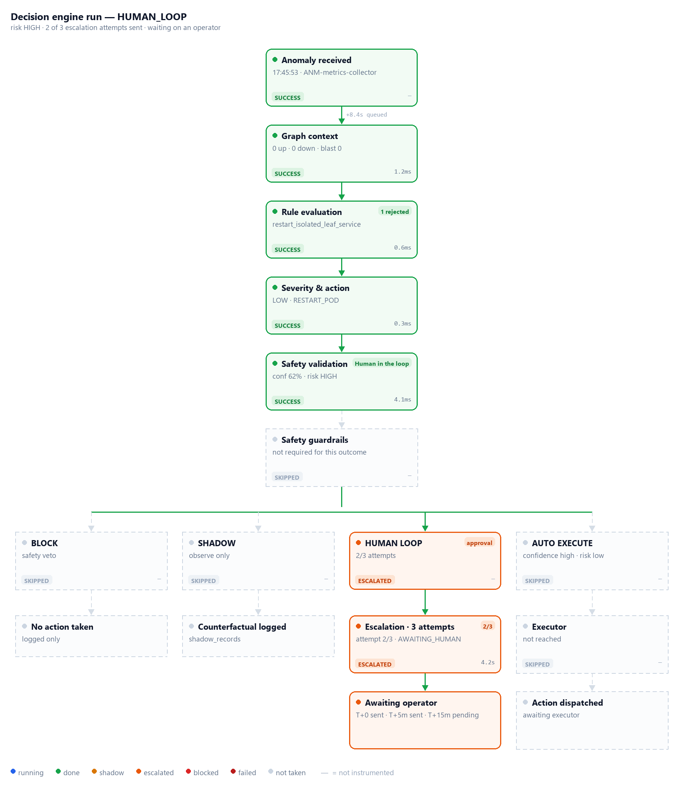
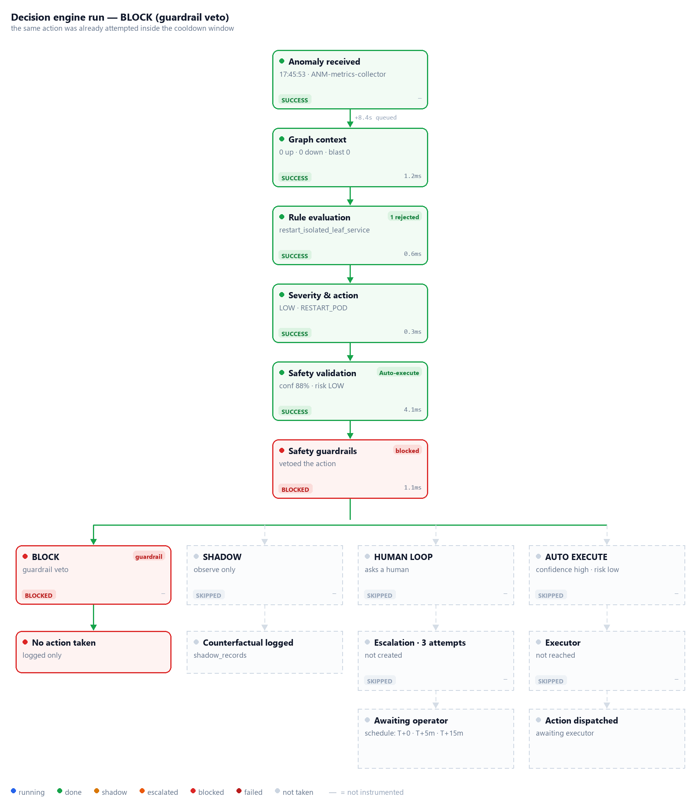

# Decision Engine Frontend — Complete Guide

Everything about the decision-engine UI: where the flow diagram lives, how it is
drawn, where every number in it comes from, and what the three operational
screens around it do.

This guide covers **Component 2, stages 4–7** (severity & action → validation →
guardrails → execution) plus the human-in-the-loop and shadow-mode surfaces.
Stages 1–3 (input processing, dependency graph, rule engine) are covered by the
existing `/anomalies`, `/dependency-graph` and `/rules` pages.

---

## 1. Where the flow diagram is

> This is the "virtual diagram" — nodes, connecting lines, colours, durations,
> notifications, failed steps and the next step.

### In the running app

| How you get there | What you see |
|---|---|
| Sidebar → **Decision Engine → Decisions** (`/decisions`), then click any row | The decision modal opens on the **Flow** tab — the diagram in a compact panel |
| In that modal, click **Open full run** | `/decisions/<decision_id>` — the full-page diagram |

Deep links work directly: `/decisions/DEC-20261118-174604-a68475`.

Two tabs sit above the diagram:

- **Flow** — the node/edge graph (default)
- **Steps** — the older expandable card list, kept because it is easier to read
  aloud in a demo and to skim on a narrow screen

Click any node to open the inspector underneath the diagram: that node's state,
its measured duration, its key/value evidence and the notifications it raised.

### In the source tree

The diagram is one small component tree. Read it in this order:

| File | Lines | Role |
|---|---|---|
| [`frontend/src/features/decisions/DecisionRunPage.tsx`](../frontend/src/features/decisions/DecisionRunPage.tsx#L24) | 138 | Route entry. Loads one decision by id, renders the flow full-width |
| [`frontend/src/features/decisions/components/DecisionFlow.tsx`](../frontend/src/features/decisions/components/DecisionFlow.tsx#L29) | 114 | Owns the Flow/Steps tabs and the selection state |
| [`frontend/src/features/decisions/data/useDecisionRun.ts`](../frontend/src/features/decisions/data/useDecisionRun.ts#L37) | 134 | Fetches the side tables for this decision |
| [`frontend/src/features/decisions/lib/runModel.ts`](../frontend/src/features/decisions/lib/runModel.ts#L219) | 1044 | **The brain.** Builds nodes, edges, states and durations from rows |
| [`frontend/src/features/decisions/components/FlowDiagram.tsx`](../frontend/src/features/decisions/components/FlowDiagram.tsx#L59) | 112 | Canvas: SVG edge layer + absolutely-positioned node cards |
| [`frontend/src/features/decisions/components/FlowNode.tsx`](../frontend/src/features/decisions/components/FlowNode.tsx#L86) | 192 | One node card, including the state→colour map |
| [`frontend/src/features/decisions/components/FlowLegend.tsx`](../frontend/src/features/decisions/components/FlowLegend.tsx) | 51 | Colour key under the canvas |
| [`frontend/src/features/decisions/components/RunSummary.tsx`](../frontend/src/features/decisions/components/RunSummary.tsx#L40) | 110 | Verdict strip: outcome, timings, "stopped at" |
| [`frontend/src/features/decisions/components/RunInspector.tsx`](../frontend/src/features/decisions/components/RunInspector.tsx#L32) | 156 | Per-node detail panel |
| [`frontend/src/features/decisions/types.ts`](../frontend/src/features/decisions/types.ts#L31) | 152 | `RunNode`, `RunEdge`, `RunSummary`, `DecisionRun` |

If you only read one file, read `runModel.ts`. It is pure TypeScript — no React,
no fetching — so the entire diagram can be reasoned about (and tested) without
rendering anything.

### As static images (for the report)

Three pre-rendered illustrations live in `docs/diagrams/`:

```text
docs/diagrams/
├── decision-engine-flow-auto.png     AUTO_EXECUTE — guardrails passed, executor ran
├── decision-engine-flow-human.png    HUMAN_LOOP — 2 of 3 attempts sent, awaiting operator
├── decision-engine-flow-block.png    BLOCK — guardrail vetoed the action
└── generate_decision_flow.py         regenerates all three
```







These are regenerated from the same geometry constants as the live component:

```bash
python docs/diagrams/generate_decision_flow.py
```

They are flat renderings for print, not screenshots — the app draws HTML cards
over an SVG edge layer with Tailwind tokens, so the exact hues differ slightly
between the PNGs and the browser.

---

## 2. What the diagram shows

### The canvas

A fixed-coordinate canvas, **900 × 958 design pixels**, scaled into whatever
width it is given. There is no force layout, no auto-placement and no random
component: the same decision always produces the same picture, which matters
when the diagram is used as evidence in a report.

```text
§3.1  Anomaly received
§3.2  Graph context
§3.3  Rule evaluation
§3.4  Severity & action
§3.6  Safety validation
§3.7  Safety guardrails
        │
        ├── BLOCK         → "No action taken"          (terminal)
        ├── SHADOW        → "Counterfactual logged"    (terminal)
        ├── HUMAN LOOP    → "Escalation · 3 attempts"  → "Awaiting operator"
        └── AUTO EXECUTE  → "Executor (§5.5)"          → "Outcome"
```

16 nodes: 6 on the spine, 4 in the routing row, 6 continuations (2 of which are
terminals for the columns that stop immediately).

### Node states

`RunNodeState` (`types.ts:31`) is a closed set of eight. `FlowNode.tsx:12` maps
each one to its border, fill, text and pulse colour.

| State | Token | Meaning | When it appears |
|---|---|---|---|
| `pending` | `--status-idle` | not reached yet | a stage ahead of the current one |
| `active` | `--status-active` (blue, pulsing) | the step the engine is on now | `UNVALIDATED` decision, or `AUTO_EXECUTE` with no execution row yet, or `HUMAN_LOOP` with a `PENDING` escalation |
| `success` | `--status-healthy` | completed | most stages of a finished run |
| `shadow` | `--status-shadow` (amber) | evaluated, deliberately not executed | the SHADOW branch, `DRY_RUN` executions |
| `blocked` | `--status-critical` | vetoed | the BLOCK branch, a guardrail veto |
| `escalated` | `--status-escalated` (orange) | handed to a human | HUMAN branch, `PENDING`/`AWAITING_HUMAN` escalation |
| `failed` | `--destructive` | attempted and failed | executor status `FAILED`, escalation `MANUAL_REQUIRED` |
| `skipped` | `--status-idle`, dashed, 60% opacity | branch not selected | the three outcomes that did not win |

State is **derived, never stored**. `runModel.ts` computes it from
`decision_log.policy_outcome`, `execution_log.status`,
`escalations.status` and the presence of side-effect rows.

### Edge states

| Edge | Rendering | Meaning |
|---|---|---|
| `done` | solid, 80% opacity | the flow travelled this connector |
| `active` | solid, 2px, marching dashes (`.flow-edge-active`) | currently carrying the run |
| `skipped` | dashed, 45% opacity | this path was not taken |
| `failed` | solid red | reserved; set when the target failed |

Rule of thumb implemented in
[`runModel.ts:885`](../frontend/src/features/decisions/lib/runModel.ts#L885): an
edge into an `active` node is `active`; an edge into a `pending` node is
`skipped`; everything else is `done`. Branch drops and continuations
additionally require the branch to have actually been selected.

### Durations

Every node shows a duration in the bottom-right, or `—`.

| Source | Nodes | Real? |
|---|---|---|
| `decision_log.context.timings` | graph context, rule evaluation, severity & action, validation, guardrails | ✅ measured by `job.py` with `perf_counter` |
| `execution_log.executed_at − decision_log.created_at` | Executor | ✅ measured |
| `escalations.created_at − decision_log.created_at` | Escalation (handoff latency) | ✅ measured |
| nothing | anomaly received, routing branches, terminals | `—` |

The `timings` object written by the pipeline contains:

| Key | Measured around |
|---|---|
| `queue_ms` | `anomaly.detected_at` → pipeline picked it up |
| `context_ms` | `ContextBuilder.build` (graph + telemetry query) |
| `classify_ms` | `classify(ctx)` |
| `rules_ms` | `rule_engine.evaluate(ctx)` |
| `selection_ms` | `select_recovery_action` |
| `severity_ms` | `build_decision` (severity + candidate composition) |
| `validation_ms` | `await validate(...)` |
| `guardrails_ms` | `guardrails.check` + `mark` (AUTO_EXECUTE only) |

The summary strip adds three aggregates:

- **Detect → decide** — `anomaly.detected_at` → `decision_log.created_at`
- **Pipeline compute** — sum of the instrumented stages above
- **Queued** — `total − compute`, i.e. how long the anomaly waited for the next
  10-second poll cycle. This is usually the largest number, and showing it
  separately keeps it from being mistaken for decision latency.

`persist_ms` is accepted by the frontend if a future writer adds it, but the
current pipeline does not measure it (the row has to exist before its own write
can be timed).

Historical rows, and rows written by the manual `POST /api/decisions/evaluate`
route, have no `timings` at all. Those nodes show `—` with the tooltip
"Not instrumented for this decision". Nothing is estimated or interpolated.

### Notifications

Two sources are merged into one newest-first list (`RunNotification`):

1. `GET /api/settings/notifications` — the engine's email log, filtered to this
   `decision_id` (`ANOMALY_DETECTED` / `DECISION_MADE`, with `status` of
   `SENT` / `FAILED` / `SKIPPED`).
2. `escalations.notifications[]` — one entry per escalation attempt
   (`ATTEMPT_1..3`, with `sent`, `sent_at`, `error`, `subject`).

Each notification is attached to the node it belongs to:

| Notification | Attached to |
|---|---|
| `ANOMALY_DETECTED` | Anomaly received |
| escalation attempts | Escalation · 3 attempts |
| `DECISION_MADE` when `HUMAN_LOOP` | Escalation |
| `DECISION_MADE` when `AUTO_EXECUTE` | Executor |
| `DECISION_MADE` otherwise | Safety validation |

A node with notifications shows a small envelope chip with the count; the
inspector lists every one with its subject, status, recipient and error.

### Next step

When a run is still in flight, exactly one node is `active` and the node after
it is marked **next** (a small blue chip above the card, plus `isNext` on the
model). The mapping is in `runModel.ts`:

| Condition | Active | Next |
|---|---|---|
| `policy_outcome` is `UNVALIDATED` | Safety validation | Safety guardrails |
| `AUTO_EXECUTE` and no `execution_log` row | Executor | Action dispatched |
| `HUMAN_LOOP` and escalation `PENDING` | Escalation | Awaiting operator |
| anything terminal | — | — |

Finished runs have no next step; the summary strip instead shows **stopped at**.

---

## 3. How a run is assembled

```text
GET /api/decisions/{id}                        → the decision row
        │
        ▼
useDecisionRun(decision)
        │
        ├── GET /api/anomalies/{anomaly_id}/evidence   → detected_at, score, snapshot
        ├── GET /api/executions?limit=100&service_id=  → only if AUTO_EXECUTE
        ├── GET /api/decisions/escalations?limit=100   → only if HUMAN_LOOP
        ├── GET /api/decisions/shadow?limit=100        → only if SHADOW_MODE
        └── GET /api/settings/notifications?limit=200  → always, filtered by decision_id
        │
        ▼
buildDecisionRun({ decision, anomaly, executions, escalations, shadows, notifications })
        │
        ▼
DecisionRun { nodes, edges, width, height, summary, sources }
        │
        ▼
<FlowDiagram>   SVG edges  +  <FlowNode> cards
```

Only the side tables the outcome actually writes are requested. An
`AUTO_EXECUTE` decision never queries escalations; a `HUMAN_LOOP` decision never
queries executions. Every call is failure-tolerant (`useDecisionRun.ts`) — a
missing table degrades one node, it does not blank the diagram.

### Endpoints used by this area

| Endpoint | Used by | Notes |
|---|---|---|
| `GET /api/decisions/recent?limit=` | Decisions list | polled every 5 s |
| `GET /api/decisions/{decision_id}` | Run page | single fetch + manual refresh |
| `GET /api/executions?limit=&service_id=` | Run page, Executions page | filter by `decision_id` client-side |
| `GET /api/decisions/escalations?limit=&status=` | Escalations page, Run page | |
| `POST /api/decisions/escalations/{id}/ack?decision=&actor=&note=` | Escalations page | `APPROVED` / `REJECTED` |
| `POST /api/decisions/escalations/{id}/fire` | Escalations page | debug: run next attempt now |
| `GET /api/decisions/shadow?limit=&verdict=` | Shadow page, Run page | |
| `GET /api/decisions/shadow/metrics` | Shadow page | |
| `POST /api/decisions/shadow/{id}/resolve?resolved_naturally=&resolution_time_sec=` | Shadow page | manual close |
| `GET /api/settings/notifications?limit=` | Run page | email audit log |
| `GET /api/anomalies/{id}/evidence` | Run page | anomaly row for timings/score |

### Gotcha: JSONB arrives as a string

`asyncpg` returns JSONB columns as text because the decision engine does not
install a type codec. So `escalations.notifications`, `escalations.response`,
`shadow_records.simulated_outcome` and `execution_log.detail` all arrive
**JSON-encoded inside a string**.

Everything that reads them goes through
[`frontend/src/features/decisions/lib/json.ts`](../frontend/src/features/decisions/lib/json.ts):

```ts
asJson<T>(value, fallback)   // parse-or-fallback
prettyJson(value)            // parse-then-indent for display
```

Do not call `JSON.parse` directly in a component, and do not assume an array.
If a codec is ever installed server-side, `asJson` keeps working unchanged.

---

## 4. The three operational screens

### Escalations — `/escalations`

Stage 6, human-in-the-loop. `EscalationsPage.tsx:80`.

- Queue table (service, status, attempt dots, next attempt, created)
- Status filters with live counts: `PENDING` / `AWAITING_HUMAN` / `RESOLVED` /
  `MANUAL_REQUIRED`
- Detail panel with the fixed delivery plan from `escalation/README.md §1`:
  **T+0 initial**, **T+5m reminder**, **T+15m final failure** — each row shows
  whether that attempt actually went out, its subject, timestamp and error
- **Approve** / **Reject** buttons call `POST /ack` with the operator name from
  the input box; the note field lands in the audit trail
- **Fire next attempt now** wraps the debug `/fire` route so a demo does not have
  to wait five minutes
- Resolved rows show the recorded response (decision, operator, timestamp, note)
  and, for exhausted escalations, the failure report

Poll: 15 s.

### Shadow mode — `/shadow`

Stage 5, counterfactual observer. `ShadowPage.tsx:86`.

- Metric tiles flattened from `GET /api/decisions/shadow/metrics`
  (`total_shadows`, `open`, `resolved_naturally`, `would_have_helped`,
  `unnecessary`, `still_active`, `unnecessary_action_rate`,
  `mean_resolution_time_sec`)
- Records table sorted open-first, verdict badges
  (`would have helped` / `unnecessary` / `would have harmed` / `anomaly still
  active` / `observing`)
- Detail panel showing the **counterfactual** payload next to the **actual**
  outcome, plus the observer's `learning` line
- **Resolved by itself** / **Needed help** buttons call `/resolve` for rows the
  observer has not settled

Poll: 20 s.

### Executions & guardrails — `/executions`

Stages 6 and 7. `ExecutionsPage.tsx:54`.

- `execution_log` table: time, service, action, status, message, link to the run
- Status counters (succeeded / failed / dry-run / guardrail blocks)
- **Executor mode** banner, inferred from the log: `NOT_IMPLEMENTED` with no
  `SUCCESS` means the Noop executor is active (`KUBERNETES_DRY_RUN=1`) — the
  decision reached execution but no cluster call was made
- **Guardrail blocks**: decisions whose outcome is `BLOCK` and whose reason
  starts with `guardrail blocked:` — the proof that the cooldown / counter /
  idempotency gate fired
- **Actions per service**: execution counts and last-seen time, with a note that
  `max_per_hour` (default 3) is enforced against `action_history`

Poll: 20 s.

---

## 5. Design system additions

The diagram could not reuse the existing severity tokens for two states, so
`index.css` gained four tokens plus two animations. They follow the same
`oklch` + `@theme inline` pattern as the rest of the file.

```css
/* light + dark */
--status-shadow:     /* amber  — evaluated, not executed */
--status-escalated:  /* orange — handed to a human */
--status-idle:       /* grey   — pending / skipped */
--status-active:     /* blue   — running now */
```

Registered as `--color-status-shadow` etc., so `text-status-shadow`,
`bg-status-shadow/10`, `border-status-escalated` all work as normal Tailwind
utilities.

Two animations, both scoped to this diagram and both disabled under
`prefers-reduced-motion`:

| Class | Effect | Used by |
|---|---|---|
| `.flow-edge-active` | marching dashes (`stroke-dashoffset`) | the connector into the active node |
| `.flow-node-active` | expanding ring (`box-shadow`) | the active node card |

The ring colour is passed per node through the `--flow-pulse-color` custom
property, because the keyframe needs the node's own state colour.

---

## 6. Backend changes this work required

Two fixes and one addition. All three are small and additive; the rest of the
decision engine was left alone.

### 6.1 Route order (`app/main.py`)

`GET /api/decisions/escalations` and `GET /api/decisions/shadow` returned **404**
on a live instance. `decisions.router` owns the catch-all
`GET /api/decisions/{decision_id}` and was registered first, so it swallowed
both paths and answered "decision escalations not found".

```python
# Order matters: decisions.router owns the catch-all GET /api/decisions/{decision_id}
app.include_router(escalations.router)
app.include_router(shadow.router)
app.include_router(decisions.router)
```

Verified against a running engine: both endpoints went from 404 to 200.

> Note for the report: `executions.py` already documented this exact hazard for
> `/api/decisions/executions`, which is why that router was moved to
> `/api/executions`. The same trap caught the two newer routers.

### 6.2 Per-stage timings (`app/decision/job.py`)

`poll_and_decide` now wraps each stage with `perf_counter` and records
milliseconds:

```python
t0 = perf_counter()
ctx = builder.build(anomaly, infra=_infra(sid), app=_app(sid), recent_anomalies=anomalies)
timings["context_ms"] = _ms(t0)
```

The dict is attached to `decision.timings` right before persistence and lands in
`decision_log.context.timings`. The `NO_RULE_MATCHED` path writes it too.

### 6.3 Model + API passthrough

- `models.py` — `Decision.timings: dict[str, float]`; included in
  `to_log_row()["context"]` **only when non-empty**, so rows written by other
  callers are byte-identical to before.
- `log.py` — `row_to_decision()` exposes `"timings": ctx.get("timings")`.

Consequence: durations are real from the first decision created **after a
restart**. Everything older renders `—`.

---

## 7. Verification

What was actually run, and what it proved:

| Check | Command | Result |
|---|---|---|
| Typecheck | `npx tsc -p tsconfig.app.json --noEmit` (via `node node_modules/typescript/bin/tsc`) | clean |
| Bundle | `vite build` | 3439 modules, builds; only the pre-existing chunk-size warning |
| CSS emitted | grep the built stylesheet | new tokens + both animation classes present |
| Live API | `curl` against the running engine | decision/execution/shadow/escalation shapes confirmed; caught the JSONB-as-string behaviour |
| Backend imports | `python -c "import app.decision.job, app.decision.log, app.decision.models"` | OK |
| Backend tests | `pytest tests` | **149 passed, 8 failed** — the same 8 fail with my backend edits stashed, so they are pre-existing |
| Diagrams | `python docs/diagrams/generate_decision_flow.py` | three PNGs, visually reviewed |

Not verified: the exact rendered pixels in a browser. There was no browser or
screenshot tooling available in this environment, so the layout is verified by
geometry, types, build and the static render — not by looking at the running app.

---

## 8. Limitations worth knowing

1. **`AUTO_EXECUTE` can be starved.** In a topology where every service has
   dependents, `blast.recommended_risk` is never `LOW`, so nothing reaches the
   executor. This is the engine behaving correctly, but it means the AUTO column
   of the diagram is often grey. Use a leaf service (`metrics-collector`) to see
   the green path.
2. **`NOT_IMPLEMENTED` is still "reached the executor".** With
   `KUBERNETES_DRY_RUN=1` the Noop executor writes a row, so the Executor node is
   green-ish with a `NOT_IMPLEMENTED` badge rather than falsely showing success.
3. **Guardrail blocks reshape the path.** When guardrails veto, the engine
   rewrites `policy_outcome` to `BLOCK`. The graph therefore shows a red
   **Safety guardrails** node *and* a red **BLOCK** branch, with the reason on
   both. That is the real state, not a rendering glitch.
4. **The canvas is 900 px wide.** Below ~940 px of available width the diagram
   scrolls horizontally rather than reflowing — deliberate, since a reflowed
   pipeline stops reading as a pipeline. The decision modal was widened to
   `max-w-7xl` so it fits.
5. **No zoom or pan.** Nodes are not draggable and the canvas does not zoom.
   A fixed layout keeps screenshots and report figures reproducible.
6. **No per-node timing before the instrumentation.** See §6.3.
7. **The PNGs are illustrations, not screenshots.** Same geometry and state
   vocabulary, flat colours instead of oklch tokens.

---

## 9. File inventory (this change set)

### New — decision run

```text
frontend/src/features/decisions/
├── DecisionRunPage.tsx                  138  route /decisions/:decisionId
├── lib/
│   ├── runModel.ts                     1044  states, durations, geometry, edges
│   ├── steps.ts                         210  the FlowStep list, shared by both tabs
│   ├── format.ts                         56  duration / clock / span formatting
│   └── json.ts                           38  JSONB decode helpers
├── data/
│   └── useDecisionRun.ts                134  side-table loading
└── components/
    ├── FlowDiagram.tsx                  112  canvas + edges
    ├── FlowNode.tsx                     192  node card + state colours
    ├── FlowLegend.tsx                    51  colour key
    ├── RunSummary.tsx                   110  verdict + timing strip
    ├── RunInspector.tsx                 156  per-node detail
    └── DecisionFlow.tsx                 114  tabs + selection (rewritten)
```

### New — operational screens

```text
frontend/src/features/escalations/EscalationsPage.tsx     476
frontend/src/features/shadow/ShadowPage.tsx               368
frontend/src/features/executions/ExecutionsPage.tsx       321
frontend/src/hooks/usePoll.ts                              68
```

### Modified

| File | Change |
|---|---|
| `frontend/src/lib/api.ts` | +8 fetchers, +5 row types, `timings` on `ApiDecision` |
| `frontend/src/features/decisions/types.ts` | +`RunNode`/`RunEdge`/`RunSummary`/`DecisionRun` |
| `frontend/src/features/decisions/components/DecisionDetailModal.tsx` | "Open full run" button, widened to `max-w-7xl` |
| `frontend/src/App.tsx` | +4 routes |
| `frontend/src/shared/layout/navigation.ts` | +Escalations / Shadow mode / Executions |
| `frontend/src/index.css` | +4 state tokens, +2 animations |
| `services/decision-engine/app/main.py` | router order fix |
| `services/decision-engine/app/decision/job.py` | stage timings |
| `services/decision-engine/app/decision/models.py` | `timings` field |
| `services/decision-engine/app/decision/log.py` | expose `timings` |

### New — documentation assets

```text
docs/Decision_Engine_Frontend_Guide.md      this file
docs/diagrams/decision-engine-flow-auto.png
docs/diagrams/decision-engine-flow-human.png
docs/diagrams/decision-engine-flow-block.png
docs/diagrams/generate_decision_flow.py
```

---

## 10. Running it

```bash
# backend (from services/decision-engine)
uv run uvicorn app.main:app --port 8000

# frontend (from frontend)
pnpm install
pnpm dev            # http://localhost:5173
```

Then:

1. `/decisions` — pick the newest row
2. **Flow** tab — the diagram
3. Click a node — the inspector
4. **Open full run** — the same graph at full width with the summary strip

`lib/api.ts` talks to `localhost:8000` directly (`VITE_API_BASE` overrides it) —
the Vite proxy on `/api` points at ml-backend on `:8002`, which is a different
service, so the decision-engine pages call port 8000 cross-origin (CORS is `*`).
