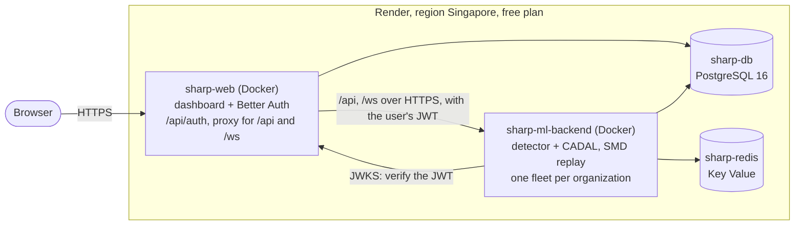

# Deploying SHARP to Render (free plan)

This guide puts the SHARP dashboard, accounts and the anomaly detection and CADAL lifecycle on
[Render](https://render.com) at no cost. Everything is defined in [`render.yaml`](../render.yaml),
so Render creates it in one step (a "Blueprint").

**What you get:** a public HTTPS URL where people create accounts and organizations, invite
teammates with roles, and each organization gets its own live replay fleet (six services
replaying real SMD telemetry), with the full Model lifecycle, Models, Logs and Dashboard pages.

**What is not on Render:** the live Online Boutique mode. It needs a Kubernetes cluster with
Prometheus and Chaos Mesh, which Render does not offer; that stays on minikube
(`infrastructure/online-boutique/`, the Helm chart). The decision engine and copilot are not
part of this deployment either; their pages fall back to their sample data.

## 1. What gets created



| Render resource | Built from | Does |
|---|---|---|
| `sharp-web` | `services/auth/Dockerfile` | Serves the dashboard (built with accounts on), runs Better Auth at `/api/auth` (accounts, organizations, roles, invitations, JWTs), forwards `/api` and `/ws` to ml-backend |
| `sharp-ml-backend` | `services/ml-backend/Dockerfile.render` | The detector and CADAL. Verifies every request's JWT and builds a separate replay fleet for each organization on first use (at most `MAX_TENANTS`) |
| `sharp-db` | Render PostgreSQL 16 | Accounts and organizations (auth tables), and every organization's lifecycle data, each row tagged with its organization |
| `sharp-redis` | Render Key Value | Event fan-out to the dashboard's live stream, and the `anomaly_events` stream |

Why one web service serves both the dashboard and accounts: the session cookie then belongs to the
page's own site. On two `*.onrender.com` hosts, browsers would treat it as a third-party cookie
and block it (`docs/adr/0016`).

## 2. Before you start

- A GitHub account with access to the repository. **Render deploys from GitHub**, so the
  branch you deploy must be pushed (this work is on `feat/cadal-production-ready`; push it, or
  merge it into `main`, when you are ready).
- A Render account (sign up with GitHub at https://dashboard.render.com; the free plan needs no
  card).
- Optional: a [Resend](https://resend.com) API key (free tier) if invitation and password reset
  emails should actually be sent. Without it, the dashboard shows each invitation link to copy,
  and reset links appear in `sharp-web`'s log.

## 3. Rehearse it on your laptop (optional, 5 minutes)

The same two images, with plain PostgreSQL 16 (no TimescaleDB, like Render's) and Redis:

```powershell
docker compose -f infrastructure/local/docker-compose.render.yml up -d --build
# open http://localhost:18080, create an account, create an organization
docker compose -f infrastructure/local/docker-compose.render.yml down -v
```

If this works, Render will too: it builds the same Dockerfiles.

## 4. Deploy

1. In the Render dashboard: **New**, then **Blueprint**. Connect GitHub if asked, pick the
   repository and the branch to deploy.
2. Render reads `render.yaml` and lists the four resources. It asks for the values marked
   `sync: false`. You don't know the URLs yet, so enter a placeholder (`https://pending`) for
   `AUTH_ISSUER`, `AUTH_JWKS_URL` and `ML_BACKEND_URL`, and leave `RESEND_API_KEY` empty or
   paste your key. Click **Apply**.
3. Wait for the builds (the first one takes about 10 to 15 minutes; ml-backend downloads its SMD
   windows during the build). Each service then shows its URL, for example
   `https://sharp-web-ab12.onrender.com` and `https://sharp-ml-backend-cd34.onrender.com`.
4. Fill in the real URLs (service, then **Environment**):

   | Service | Variable | Value |
   |---|---|---|
   | `sharp-ml-backend` | `AUTH_ISSUER` | `https://sharp-web-ab12.onrender.com` (sharp-web's URL, no trailing slash) |
   | `sharp-ml-backend` | `AUTH_JWKS_URL` | `https://sharp-web-ab12.onrender.com/api/auth/jwks` |
   | `sharp-web` | `ML_BACKEND_URL` | `https://sharp-ml-backend-cd34.onrender.com` |

   Saving restarts each service with the new values.
5. Check:
   - `https://<sharp-web>/healthz` answers `{"status":"ok"}` (the database is reachable);
   - `https://<sharp-web>/api/health` answers `{"status":"ok","auth":"jwt",...}` (the proxy reaches ml-backend);
   - `https://<sharp-web>/api/auth/jwks` lists one key.

## 5. First use

1. Open `https://<sharp-web>` and click **Get started** (or go to `/signup`). Create an account.
2. Create your organization. You become its **owner**.
3. The Model lifecycle page opens. The first visit builds your organization's fleet (about
   20 to 40 seconds on a free instance), then the six services stream live.
4. Invite teammates: **Organization** in the sidebar, enter an email and a role, **Invite**. Copy
   the link and send it (or it is emailed, with Resend configured). They open it, create an
   account with that email and accept.

| Role | Can |
|---|---|
| viewer | see every page of the organization |
| operator | also answer CADAL's "new normal or incident?" questions, run checks and demo injections, pause |
| admin | also promote and roll back models, reset the fleet, invite and manage members |
| owner | everything, including deleting the organization |

The audit trail records the signed-in user's email on every answered question and manual
transition.

## 6. Free plan limits, and what they mean for SHARP

From Render's documentation (https://render.com/docs/free, checked 2026-11-22):

| Limit | Effect on SHARP | What to do |
|---|---|---|
| A free web service sleeps after 15 minutes without requests or WebSocket messages; waking takes about a minute | An open dashboard keeps both services awake. After a sleep, ml-backend starts fresh: each organization's replay fleet is rebuilt on the next visit (replay is a demo; accounts and organizations are kept in PostgreSQL) | Open the site a minute before a demo |
| 750 free instance hours per workspace per month; when they run out, all free web services are suspended until the next month | Two services kept awake around the clock would use about 1,490 hours | Let them sleep when unused; don't add an uptime pinger to both |
| The free PostgreSQL expires 30 days after creation (14 more days to upgrade, then it is deleted); 1 GB; one per workspace; no backups | Accounts and organizations are lost when it is deleted | Upgrade the database before day 30, or recreate it and sign up again |
| Free Key Value keeps no data across restarts | Nothing lost: it only carries live events | None |
| 512 MB of memory per free instance (Render's free instance type) | ml-backend uses about 260 MB with one organization's fleet and about 40 MB more per further organization; `MAX_TENANTS=3` keeps it under 512 MB. A fourth organization gets a "capacity" message | Raise `MAX_TENANTS` only on a paid instance |
| Free web services cannot receive private network traffic | sharp-web reaches ml-backend over its public HTTPS URL | Already handled (step 4) |
| No persistent disk, files are lost on restart | Nothing is written to disk | None |

To go always-on, move `sharp-web` and `sharp-ml-backend` to the Starter instance type and the
database to a paid plan in each resource's **Settings**; nothing in the code changes.

## 7. Updating

Pushes to the deployed branch redeploy automatically (both services rebuild). The database schema
migrates itself on startup: Better Auth's tables in `sharp-web`, the lifecycle tables in
`sharp-ml-backend` (`infrastructure/local/init.sql`, idempotent).

## 8. Troubleshooting

| Symptom | Cause | Fix |
|---|---|---|
| Every page bounces back to sign in, or the dashboard says ml-backend is not running | ml-backend rejects the JWT: `AUTH_ISSUER` differs from sharp-web's URL (scheme, trailing slash) or `AUTH_JWKS_URL` is wrong | Correct the values (step 4); check `sharp-ml-backend`'s log for `401` |
| `/api/health` returns "Error occurred while trying to proxy" | ml-backend is asleep, starting, or `ML_BACKEND_URL` is wrong | Wait a minute and reload; check the variable |
| "your organization has no monitored fleet" or "already runs 3 organizations' demo fleets" | The `MAX_TENANTS` cap was reached | Raise `MAX_TENANTS` on a larger instance, or remove unused organizations |
| Invited person sees "the invitation is for ..." | They signed in with another email | Sign in with the invited address |
| No emails arrive | No `RESEND_API_KEY`, or Resend's test sender only delivers to your own address | Copy invitation links from the Organization page; verify a domain in Resend for real delivery |

## 9. Security notes

- `BETTER_AUTH_SECRET` is generated by Render and never leaves it. Session cookies are
  `Secure` and `HttpOnly` on HTTPS.
- ml-backend trusts nothing but a JWT signed by sharp-web's key (Ed25519, 15 minutes), checked
  for issuer, audience and expiry. A user's organization and role come from that token, never from
  the request.
- Organizations cannot see each other: every runtime, database row, event channel and metric
  series carries the organization id (`docs/adr/0015`).
- Never put real credentials in `render.yaml`; use `sync: false` variables.
