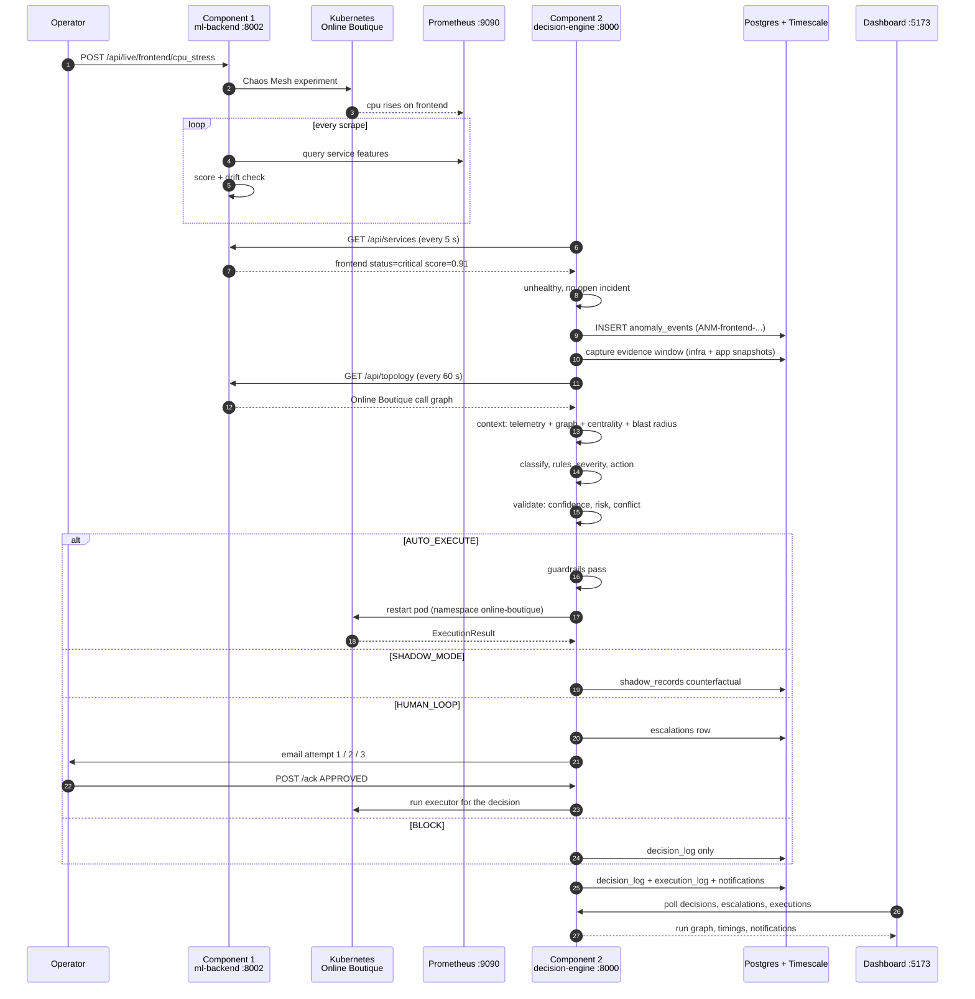
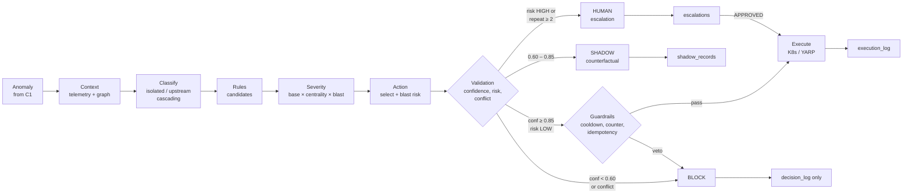
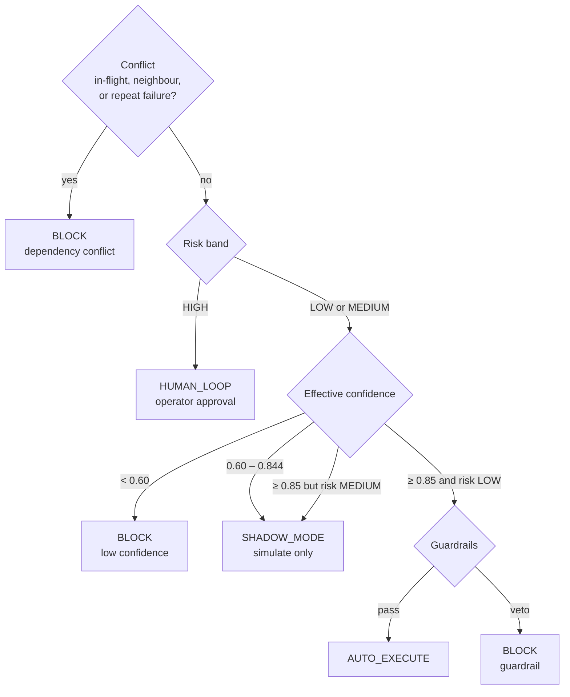
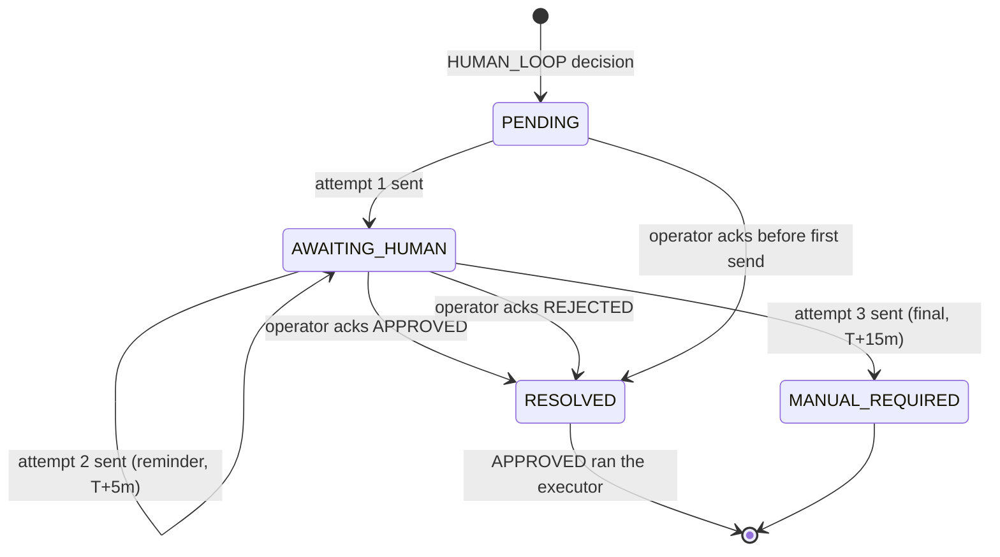
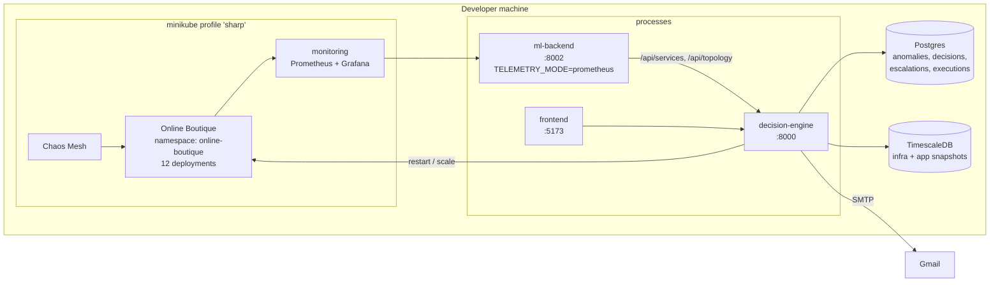

# Decision Engine — Mermaid diagrams

Renders in GitHub, VS Code Markdown Preview, or <https://mermaid.live>.
The full implementation diagram is [`decision-engine-full.mmd`](decision-engine-full.mmd);
this file holds the focused views used in the report.

| # | Diagram | Use |
|---|---|---|
| 1 | Live incident sequence | shows the C1 → C2 handoff end to end |
| 2 | Decision pipeline | the seven stages, one line each |
| 3 | Outcome tree | the policy matrix as a decision tree |
| 4 | Escalation state machine | PENDING → AWAITING_HUMAN → RESOLVED / MANUAL_REQUIRED |
| 5 | Component deployment | ports, processes, datastores |

---

## 1. Live incident sequence

---

## 2. Decision pipeline

---

## 3. Outcome tree (policy matrix)

---

## 4. Escalation state machine

---

## 5. Deployment view

---

## 6. Where each diagram comes from in code

| Diagram element | Source |
|---|---|
| anomaly creation, dedupe, capture window | `app/ingestion/anomaly_sink.py` |
| topology load + 60 s refresh | `app/integration/topology.py` |
| catalog (local ∪ graph) | `app/integration/catalog.py` |
| telemetry + provenance | `app/integration/telemetry.py`, `build_telemetry` |
| classify / rules / severity / action | `app/rules/`, `app/decision/{severity,action_selector,blast_analysis}.py` |
| validation + policy matrix | `app/decision/validation/{confidence,risk_classifier,conflict_detector,policy_matrix}.py` |
| guardrails | `app/decision/guardrails/{cooldown,action_counter,idempotency}.py` |
| escalation + approval execution | `app/decision/escalation/{queue,worker,approval}.py` |
| execution | `app/decision/executor_kubernetes.py` |
| timings + C1 provenance | `app/decision/job.py` |
| dashboard rendering | `frontend/src/features/decisions/` |
